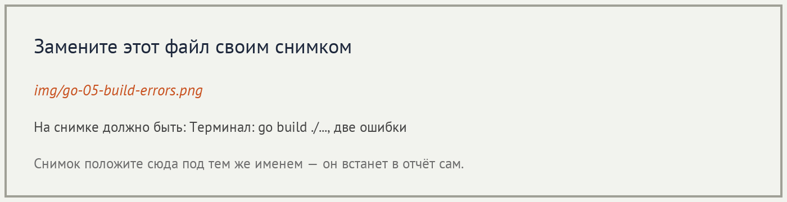

# Отчёт · Проверка типов: gopls, go build и go vet

**Студент:** ✏️ Фамилия Имя, группа ✏️

## 1. Подготовка


## 2. Проверка в редакторе

```go
✏️ содержимое proba/main.go — два вызова с аргументами не того типа
```


Разбор сообщения:

| Часть сообщения | Что означает |
|---|---|
| ✏️ | ✏️ |
| ✏️ | ✏️ |
| ✏️ | ✏️ |


## 3. Проверка в терминале

```text
✏️ вывод go build ./... с ошибками
```



```text
✏️ вывод go build ./... && go vet ./... после исправления
```

## 4. Проект с ошибками типов


| Этап | Ошибок в `go build ./...` | Ошибок в Problems |
|---|---|---|
| исходно | ✏️ | ✏️ |
| после `internal/utils` | ✏️ | ✏️ |
| после `internal/domain` | ✏️ | ✏️ |
| после `internal/services` | ✏️ | ✏️ |
| после `main.go` | ✏️ | ✏️ |

✏️ Почему число ошибок в терминале на одном из этапов выросло.

Пакет до и после — ✏️ имя пакета:

```go
✏️ строки с ошибками
```

```go
✏️ те же строки после исправления
```

```text
✏️ вывод: go build ./... && go vet ./... && go test ./... && go run .
```


## 5. Выводы

✏️ Три–пять предложений: чем отличаются gopls, `go build` и `go vet`,
что оказалось неожиданным, чего компилятор не находит.
