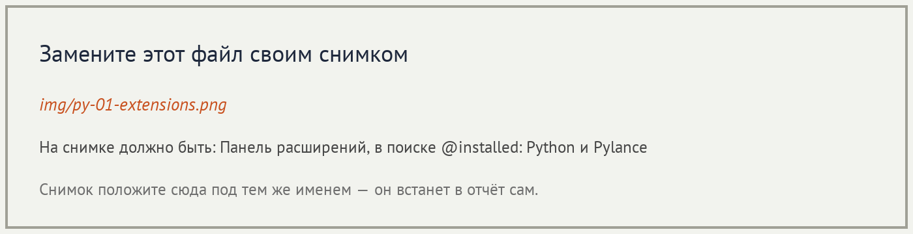
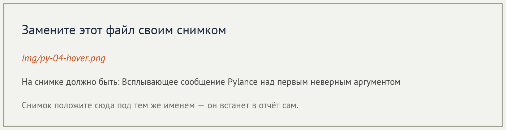
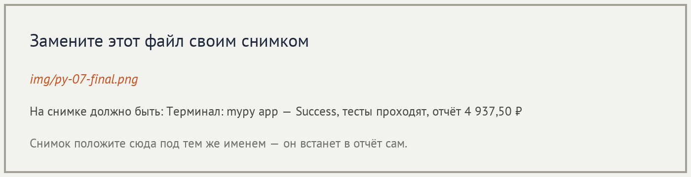

# Отчёт · Проверка типов: Pylance и mypy

**Студент:** ✏️ Фамилия Имя, группа ✏️

## 1. Подготовка




## 2. Проверка в редакторе

```python
✏️ содержимое proba.py — два вызова с аргументами не того типа
```




Разбор сообщения:

| Часть сообщения | Что означает |
|---|---|
| ✏️ | ✏️ |
| ✏️ | ✏️ |
| ✏️ | ✏️ |


## 3. Проверка в терминале

```text
✏️ вывод mypy proba.py с ошибками
```


```text
✏️ вывод mypy proba.py после исправления
```

## 4. Проект без аннотаций

| Этап | Итог `mypy app` |
|---|---|
| исходно | ✏️ |
| после `utils` | ✏️ |
| после `domain` | ✏️ |
| после `services` | ✏️ |
| после `ui` | ✏️ |

Модуль до и после — ✏️ имя модуля:

```python
✏️ подписи функций без аннотаций
```

```python
✏️ те же подписи с аннотациями
```

```text
✏️ вывод: mypy app, python -m pytest -q, python main.py
```



## 5. Выводы

✏️ Три–пять предложений: что находят Pylance и mypy, что оказалось
неожиданным, чего проверка типов не находит.
