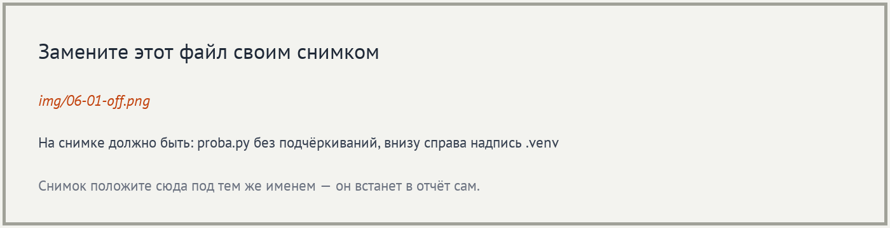
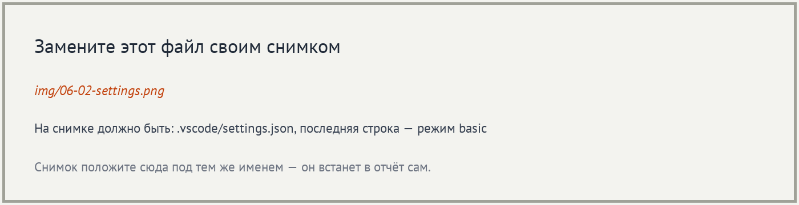
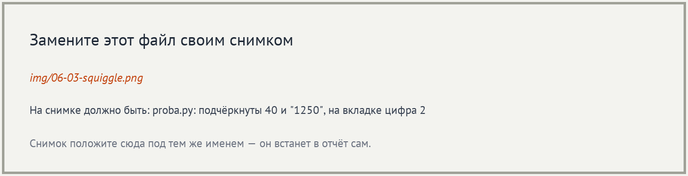
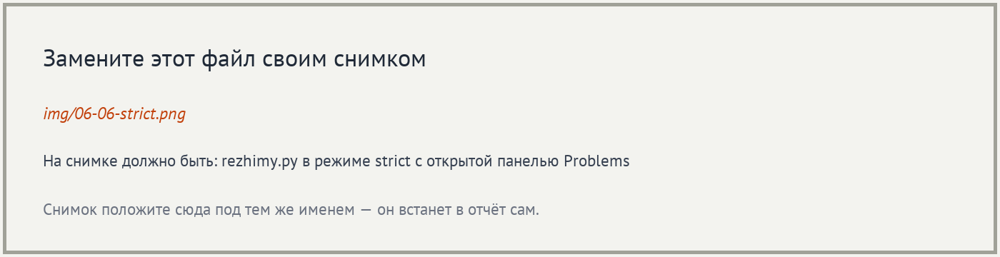
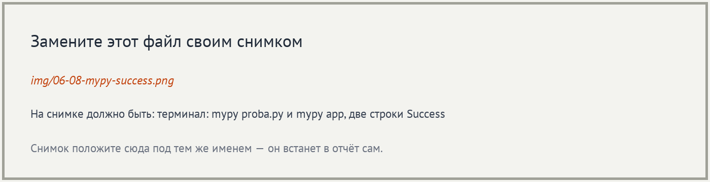
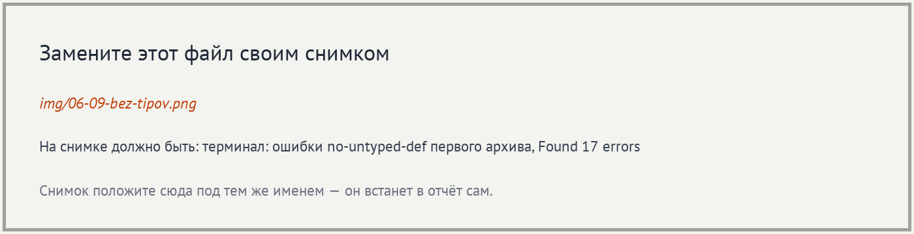
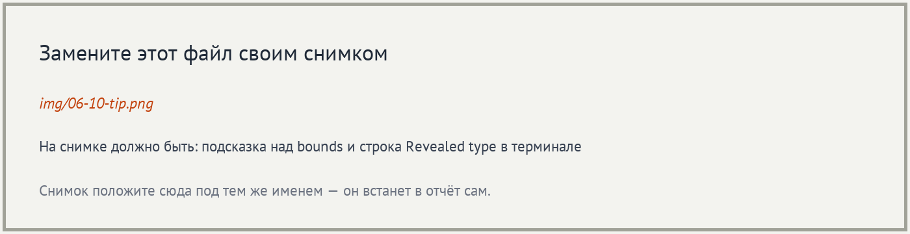

# Отчёт · Проверка типов: Pylance и mypy

**Студент:** ___, группа ___
**Номер в журнале:** ___, вариант шага 4: ___

Работа выполнена на втором архиве проекта «Отчёт кафе»
(`lesson_06/otchet-kafe-start`), глава 4.3.

## 1. Редактор до настройки

В корне проекта создан файл `proba.py` с двумя неверными вызовами:
`format_title(40)` и `format_kopeks("1250")`. Выбран интерпретатор
из окружения проекта, внизу справа окна написано `.venv (___)`.

В режиме `off` в файле подчёркнуто ___ аргументов. Ошибки типов в этом
режиме не показываются, аннотации идут только в подсказки.

## 2. Включение режима basic

Настройка `python.analysis.typeCheckingMode` выбрана на вкладке ___,
поэтому VS Code записал её в файл `___` внутри проекта.

## 3. Ошибки в редакторе

После смены режима в `proba.py` подчёркнуты ___ и ___. На вкладке
после имени файла стоит цифра ___.

Сообщение над `40`:

Pylance называет тип переданного значения `___`. Параметр `___`
функции `format_title` ожидает тип `___`. Правило, по которому
выдано сообщение, называется `___`.

## 4. Моя ошибка и панель Problems

Мой вариант — ___. В `proba.py` добавлен вызов `___`, он стоит
в строке ___. Функция объявлена в модуле `___`, её подпись:
`___`.

В панели Problems у `proba.py` ___ ошибки. Моя ошибка стоит
на месте `[Ln ___, Col ___]`, её короткая причина в конце сообщения:
`___`.

## 5. Четыре режима на одном файле

Файл `rezhimy.py` проверен во всех четырёх режимах.
Число сообщений в панели Problems:

| Режим | Сообщений |
|---|---|
| `off` | ___ |
| `basic` | ___ |
| `standard` | ___ |
| `strict` | ___ |

Только в `standard` и `strict` появилось сообщение про переменную
`label`: `___`. После опыта возвращён режим `basic`.

## 6. Ошибки в терминале

Версия mypy: `___`. Команда `mypy proba.py` закончилась строкой
`Found ___ errors in ___ file (checked ___ source file)`.

Строка с моей ошибкой: `proba.py:___: error: ___  [___]`.
В сообщении mypy параметр назван `___`, а Pylance называл его `___`.

## 7. Исправление

Исправленные вызовы:

| Было | Стало |
|---|---|
| `format_title(40)` | `___` |
| `format_kopeks("1250")` | `___` |
| `___` | `___` |

После сохранения файла проверка повторена.

`mypy proba.py`: `Success: no issues found in ___ source file`.
`mypy app`: `Success: no issues found in ___ source files`.

## 8. Проект без аннотаций

На первом архиве mypy вывел `Found ___ errors in ___ files`.
У всех ошибок код `___`. Ошибки появились потому, что в `pyproject.toml`
включён параметр `___`.

Первая строка списка: `___`.

## 9. Какой тип видит проверка

Pylance при наведении на `bounds` показал `___`. mypy в строке
`reveal_type` вывел `___`.

## 10. Итог

Если Pylance ошибок не показывает, а mypy показывает, первым делом
проверяю, ___.

Не получилось: ___

ИИ: не использовался / использовался для ___
