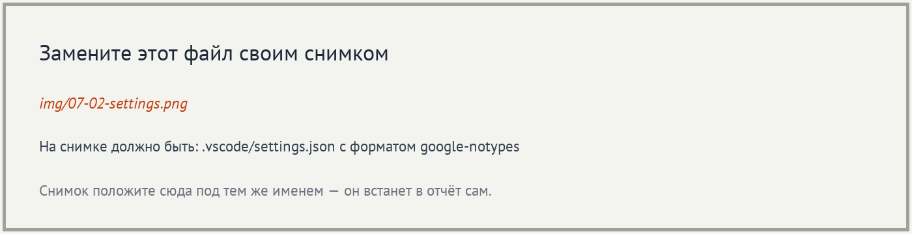
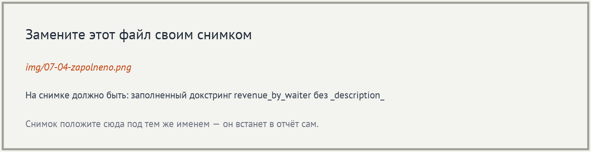
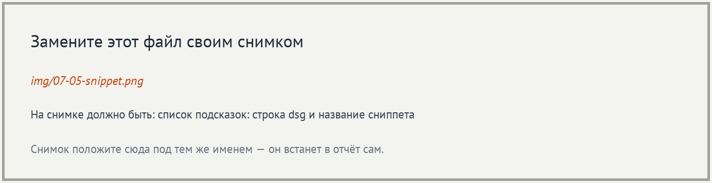
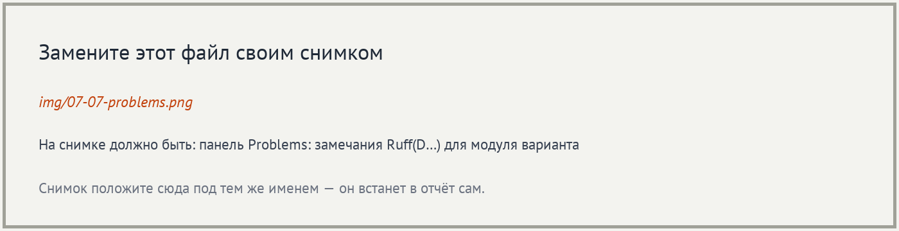
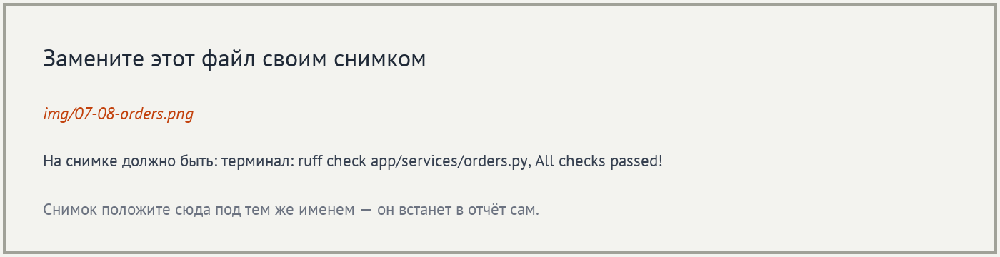

# Отчёт · Докстринги в VS Code: генератор и проверка

**Студент:** ___, группа ___
**Номер в журнале:** ___, вариант шагов 7 и 10: ___, модуль `___`

Работа выполнена на втором архиве проекта «Отчёт кафе»
(`lesson_07/otchet-kafe-start`), глава 4.10.

## 1. Расширения

Установлены расширения `njpwerner.autodocstring` и `charliermarsh.ruff`.
Автор autoDocstring на карточке расширения: ___. Издатель Ruff: ___.


## 2. Настройки проекта

Настройки генератора записаны в файл `___`. Он лежит внутри проекта
и попадает в репозиторий, поэтому заготовка у всех, кто откроет проект,
будет ___.



Формат заготовки — `___`. С проверкой Ruff он согласуется, потому что
в `pyproject.toml` записано `convention = "___"`. Настройка
`startOnNewLine` оставлена `___`: иначе Ruff выдаст замечание `___`.

## 3. Заготовка генератора

Генератор вызван у функции `revenue_by_waiter` способом: ___.


В заготовке разделы `___`, `___` и `___`. Раздел `Raises:` появился,
потому что в теле функции есть `___`. Типов в скобках нет, потому что
выбран формат ___.

## 4. Заполненный докстринг



Краткая строка: «___». Параметр `top` описан так: «___».

## 5. Сниппет

Сниппет записан в файл `___`. Его название — «___», слово для вызова —
`___`. Им вставлен докстринг функции `load_orders`.



Имя параметра `path` в сниппет вписано вручную: сниппет вставляет ___
текст для любой функции и подпись не читает.

## 6. Проверка всего пакета

Команда `ruff check app --output-format=concise` закончилась строкой
`Found ___ errors.`


Чаще других в выводе два кода. `D100` означает: ___.
`D103` означает: ___.

## 7. Замечания в редакторе

Модуль моего варианта — `___`. В панели Problems у него ___ замечания.
Источник у каждого замечания — `___`.



## 8. Модуль orders.py без замечаний

Докстринг модуля `orders.py`: «___».
Докстринг `sort_orders_in_place`: «___».



## 9. Опыт с D417

После удаления строки про `top` проверка вывела:
`___`.


Правило D417 сравнивает раздел `Args:` с ___. Остальные правила
из вывода проверяют, есть ли докстринг и как он оформлен. После опыта
строка про `top` возвращена.

## 10. Модуль моего варианта

До работы проверка модуля `___` выводила `Found ___ errors.`, после —
`All checks passed!`. В пакете `app` осталось `Found ___ errors.`


Докстринг одной из функций модуля:

```python
___
```

## 11. Итог

Ruff проверяет, что докстринг есть, оформлен по правилам и перечисляет
все параметры подписи. Верность описания по смыслу Ruff не проверяет:
докстринг с текстом `___` для него в порядке.

Не получилось: ___

ИИ: не использовался / использовался для ___
